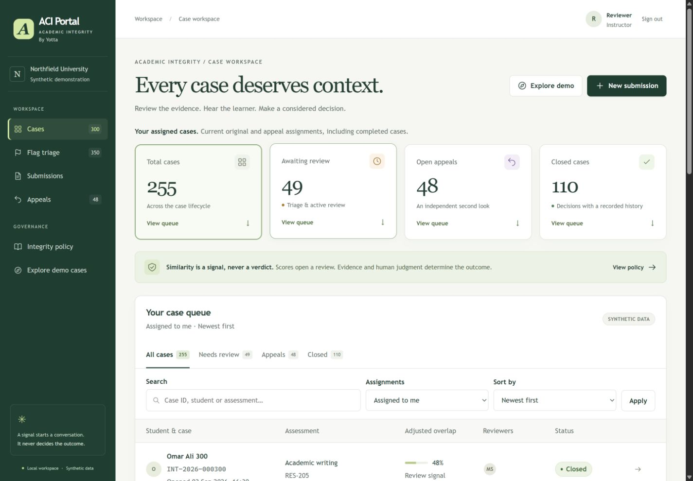

# ACI (Academic Integrity) Portal By Yotta

**Version 1 · `v1.0.0`** — initial working baseline. See [release notes](CHANGELOG.md). Future interface and workflow enhancements build on this tagged version.

A local workspace that takes synthetic similarity flags through human triage, evidence review, reasoned decisions, and independent appeals. A score starts a review; it never decides guilt.

Built with Django, SQLite, and responsive custom templates. Everything required to run and review the project is in this repository; nothing depends on its parent directory.



## Run locally

Prerequisite: **Python 3.12–3.14**, with pip and venv. First installation needs internet; runtime uses no cloud services, external database, API keys, CDN assets, Node.js, or Docker.

```sh
git clone https://github.com/rahulsharma027/yottaflex-round-3-assignment.git
cd yottaflex-round-3-assignment
python run.py
```

On Windows, `py -3.14 run.py` selects a supported interpreter. On macOS/Linux use `python3` if needed. Python 3.15 is accepted experimentally with a warning; Django 5.2 does not officially support it. See [actual verification](docs/VERIFICATION.md).

The launcher creates an isolated `.venv`, installs pinned dependencies, generates local configuration, applies migrations, seeds **10,000 submissions / 1,000 flags / 300 cases**, and creates ten demo accounts across the five roles. Open the printed URL, normally [http://127.0.0.1:8000](http://127.0.0.1:8000). Start with `academic-admin`; random passwords are printed locally and saved in ignored `.local/demo-accounts.json`. Stop with Ctrl+C. Subsequent runs preserve all reviewer changes and passwords.

```sh
python run.py --port 8001               # occupied default port
python run.py --setup-only              # prepare without starting a server
python run.py --mode starter            # empty database only: 100 submissions / 10 flags / 3 cases
python run.py --reset-demo --confirm-reset  # explicitly DELETE local changes and reseed
```

Stop the server before resetting. A reset requires both flags, retains the signing secret, and generates new passwords. Changing `--mode` does not replace existing data. Set `YOTTA_LOCAL_DIR` to use an independent workspace; never publish that directory. Back up `.local/yotta.sqlite3` while stopped to preserve interactive work.

### Your first sign-in

The login page includes a **Your first sign-in** guide. Select **Use this username** for `academic-admin`, then paste that account’s generated password from the launcher terminal. **Can’t find the password?** explains the credentials file and how to print the details again with `python run.py --setup-only`. **Want to try a different role?** describes the accounts and provides username shortcuts. Each account still requires its own password.

After signing in as administrator, start with **Explore demo cases**, then try **Flag triage**. See the [desktop guide](docs/screenshots/login-guide-desktop.png) and [phone guide](docs/screenshots/login-guide-phone.png).

## Explore

| Account | Purpose |
|---|---|
| `academic-admin` | Triage, assignments, in-app notice, closure, validation |
| `reviewer` | Original decisions on assigned cases |
| `second-reviewer` | Additional original reviewer |
| `appeal-reviewer` | Assigned independent appeal review |
| `learner` | Own submissions, response, evidence, and appeal |
| `support` | Evidence and in-app notice; cannot assign or decide |
| `platform-admin` | Same academic controls/evaluation access as academic-admin |

Additional instructor accounts `reviewer-theo`, `reviewer-anika` and `reviewer-evan` let all six reviewer profiles participate. Evan has a documented conflict with learner LRN-00001 and cannot review that learner's cases.

Reviewer accounts open **Assigned to me**, sorted by case opening date newest first. Select **All cases** above the status tabs to switch scope immediately, or **Assigned to me** to return. **All statuses** clears only the status filter. Summary cards show counts within the selected scope; selecting one updates and smoothly scrolls to its filtered queue. Search, status, assignment, sorting and pagination remain in the URL when returning from a case.

The assignment switch appears only for reviewers (including appeal reviewers). Administrators and support see all authorized cases; learners see only their own cases.

Case files lead with student details and the original submitted work, then evidence, learner response, decisions and the complete timeline. Section links jump directly to each part or to the case actions. The submitted text remains escaped, and learner access remains limited to their own cases.

**Explore demo cases** links to legitimate quotation, template overlap, multiple reviewers, and a successful appeal. Follow [WALKTHROUGH.md](docs/WALKTHROUGH.md) to create your own complete review and appeal. Permissions are enforced on the server, including learner ownership and decision author assignment.

## Verify and export

After setup, on Windows:

```powershell
.venv/Scripts/python.exe manage.py check
.venv/Scripts/python.exe manage.py test
.venv/Scripts/python.exe scripts/verify_dataset.py --package
.venv/Scripts/python.exe manage.py generate_data --mode full --seed 20261022 --output artifacts/export
```

On macOS/Linux replace `.venv/Scripts/python.exe` with `.venv/bin/python`. Tests use a separate temporary database. `python scripts/verify_dataset.py --package` also runs using only the Python standard library.

[data/full-dataset.zip](data/full-dataset.zip) contains full JSON, per-table CSV, standalone SQLite SQL, a source/checksum manifest, separate ground truth, and four isolated invalid fixtures. [data/verification.json](data/verification.json) records actual counts, findings, metrics, and two-run SHA-256 equality. The administrator validation screen explicitly evaluates that packaged baseline, rather than your live changes.

## Documentation and code

| Document | Contents |
|---|---|
| [Architecture](docs/ARCHITECTURE.md) | Components, ERD, lifecycle, permissions, decisions and limits |
| [Schema](docs/SCHEMA.md) | Every application field, generated from model metadata |
| [Dataset](docs/DATASET.md) | Scenario rules, provenance, exports, validation, metric formulas |
| [Requirements](docs/REQUIREMENTS.md) | Requirement → implementation → evidence |
| [Verification](docs/VERIFICATION.md) | Real checks, environment, setup measurements and unverified work |
| [Development log](docs/DEVELOPMENT.md) | Component sequence and remaining work |
| [AI disclosure](docs/ai/AI_USE.md) | Actual AI reliance and candidate review status |
| [Prompt history](docs/ai/PROMPT_HISTORY.md) | Partial record and export limitations |

Code: `integrity/models.py` (schema), `services.py` (authorized transactional writes), `forms.py`/`views.py` (HTTP), `dataset.py`/`validation.py` (generation/evaluation), `tests/`, `templates/`, and `static/`. Restart the launcher after Python changes. Regenerate the field dictionary with `python scripts/document_schema.py` inside the virtual environment.

## Boundaries

This is a single-institution **local assessment app** with fictional records and a loopback development server. Similarity is simulated. Source references are plain text; there are no attachment uploads or external fetches. Notices are in-app, not emailed. Cases support multiple reviewers, one original decision, and one independent appeal decision; original evidence/decisions remain visible.

SQLite serializes writes; atomic actions and version checks guard stale edits. History is application-managed, not tamper-proof against database administrators. There is no production rate limiting, SSO/MFA, password recovery, or hosting. Policy and conflict changes are seed/migration-driven. No portal submission or hosted demo is claimed. Planning docs remain as historical context; README and implementation docs describe current behavior.
