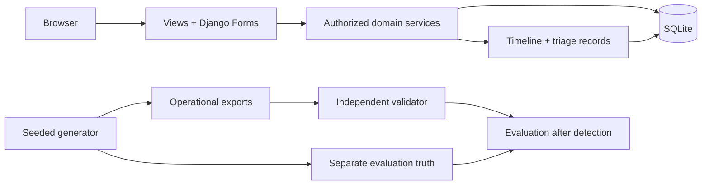
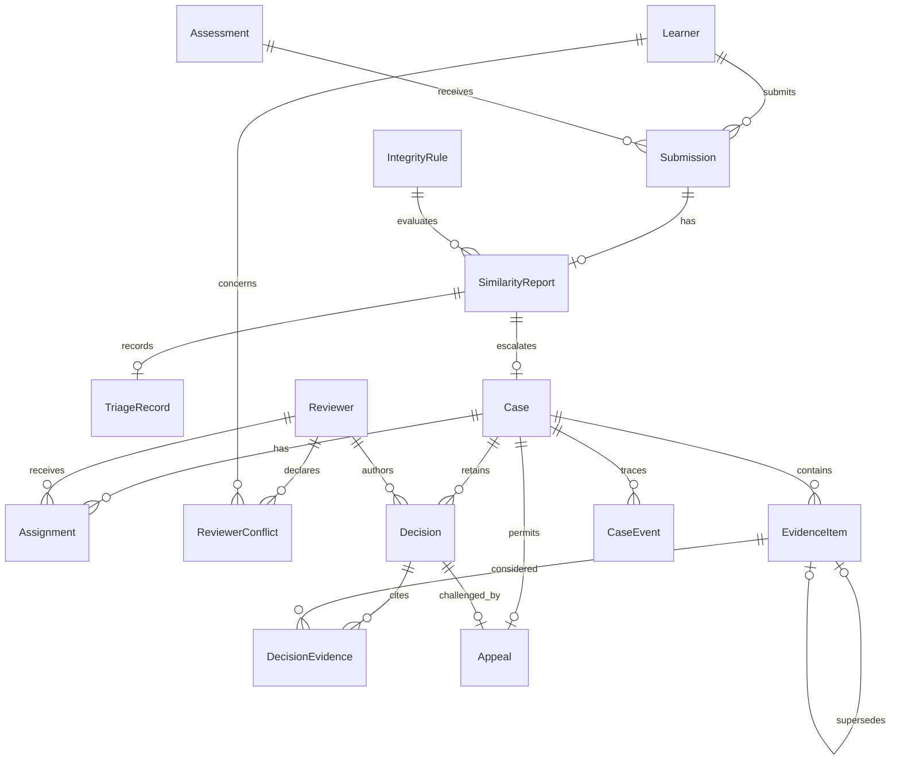
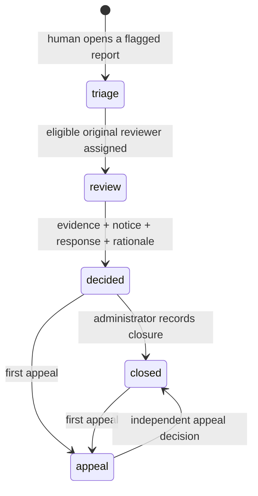

# Architecture and decisions

One Django application, server-rendered HTML, custom responsive CSS, progressive-enhancement JavaScript, and SQLite. Authentication, sessions, CSRF, forms, migrations, and test isolation come from Django. Assets are local. A React/FastAPI alternative would add separate installation/build, API integration, and authentication work without a concrete assessment need.

`services.py` is the write boundary. Services check role, ownership, phase, state, assignment, conflict, evidence, rationale and learner response. Domain mutations and audit events share one `transaction.atomic`. SQLite uses BEGIN IMMEDIATE and a 20-second timeout to serialize short writes. A conditional version update claims a case; stale/repeated actions roll back. Transactional counters allocate immutable IDs. A user-bound hashed request receipt makes submission creation idempotent even for concurrent repeats. Client button disabling is only a convenience.

## Stack and sizing assumptions

Django **5.2.18 LTS** was confirmed on PyPI and the [official download page](https://www.djangoproject.com/download/) on 2026-10-30. [Official compatibility](https://docs.djangoproject.com/en/5.2/faq/install/) covers Python through 3.14; this project recommends 3.12–3.14. The host's 3.15.1 is explicitly experimental. Passing local checks is not an official compatibility guarantee.

Design assumptions, not requirements: one institution, public synthetic demo data, roughly 20 reads/write, fewer than three requests/second, occasional concurrent browser tabs. Local latency p50/p95/p99 targets are 200/500/800 ms; they are not measured SLOs. Availability means the reviewer’s running local session, not a hosted uptime contract. Reviewer owns local backups; synthetic data regenerates, but recovering interactive edits needs a prior backup. No zero-loss RPO is promised. PostgreSQL and institutional identity would be next steps for concurrent real use.

## Relationships

Required parents are non-null protected foreign keys. A submission has at most one report here; creation atomically supplies one. Flag means `SimilarityReport.flagged`. Reports have optional triage/case records. Case-to-reviewer and decision-to-evidence use explicit bridges. One case retains multiple assignment/evidence histories, one original decision, one appeal and one appeal decision. Optional local user links connect synthetic learners/reviewers to authentication. [SCHEMA.md](SCHEMA.md) lists every field.

## Lifecycle

Case state, flag/triage status and decision outcome are distinct: closed never means guilty. Policy threshold snapshots preserve the rule used at report time. Policy changes must create new versions instead of rewriting history.

Assumptions: in-app notice and learner response precede decisions; no statutory waiting period is invented. Only an eligible assigned reviewer authors a decision. Multiple reviewers may participate, but consensus voting is outside scope. Reassignment ends an assignment and creates another. All original involvement, including ended assignments, disqualifies a reviewer from an appeal. Recorded learner conflicts apply across that learner's cases.

Appeal outcome comparison derives upheld/overturned and preserves the original finding. Pending appeals cannot close administratively. Evidence corrections append a new item using `supersedes`; earlier decisions retain original references. New decisions select current evidence. Late evidence requires an open appeal, with a new provenance event. Learner response displays the latest text; earlier responses remain in the timeline.

## Permission matrix

| Action | Learner | Instructor | Academic admin | Support | Platform admin |
|---|---|---|---|---|---|
| View operational work | Own only | All synthetic | All | All | All |
| Create submission/report | Own only | Yes | Yes | No | Yes |
| Triage flag | No | Yes | Yes | No | Yes |
| Assign/reassign | No | No | Yes | No | Yes |
| Record notice | No | No | Yes | Yes | Yes |
| Submit learner response | Own only | No | No | No | No |
| Add/version evidence in open review | Own only | Yes | Yes | Yes | Yes |
| Decide | No | Assigned eligible only | Assigned eligible only | No | Assigned eligible only |
| Submit appeal | Own only | No | Yes | No | Yes |
| Close decided case | No | No | Yes | No | Yes |
| Evaluation access | No | No | Yes | No | Yes |

Seeded administrator accounts are deliberately not reviewer profiles. There is no unrestricted Django admin route. Staff read access is institution-wide for this synthetic demonstration, not a real confidentiality/tenancy policy.

## Security and limits

Django hashes passwords, validates CSRF, signs sessions, escapes templates and parameterizes ORM writes. Logout is POST-only. Learner ownership is enforced; inaccessible cases return 404. Return URLs are same-origin checked. Forms enforce lengths/ranges; services independently enforce consequential rules. SQL export identifiers are fixed generator-owned names; row values use bound parameters. Source references are text and never fetched or trusted as HTML.

Secrets, passwords, databases, virtual environments and temporary exports are ignored. Loopback HTTP and `runserver --insecure` serve local static assets only. Production rate limiting, MFA/SSO, password recovery, email, uploads, encryption/backup automation, institutional tenancy, and hosting are outside scope. Database administrators can alter application-managed history. Policies/conflicts are seed/migration-driven, not editable UI. SQLite can delay or reject heavy contention.

For an interview, trace form → scoped view → service authorization → version claim → atomic mutation/event → redirect. Explain warning versus finding, conflicts versus independence, retained DecisionEvidence references, separate truth, and seed/date/order/encoding repeatability. Candidate personal review still needs to be recorded honestly.
